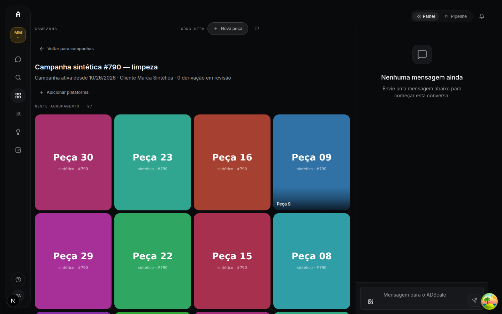
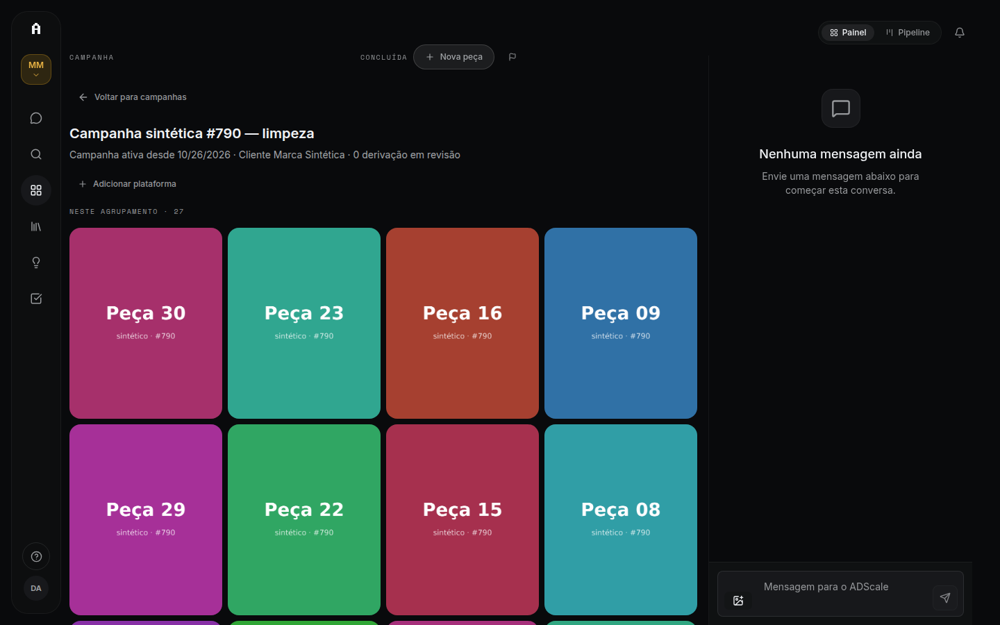
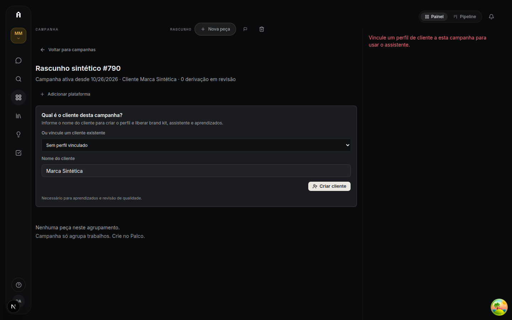
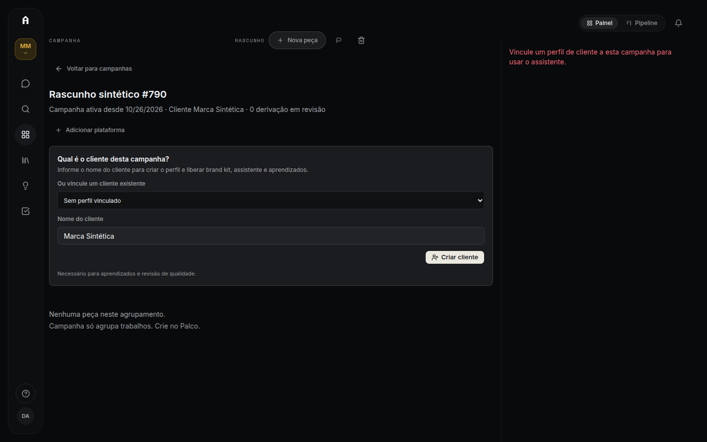
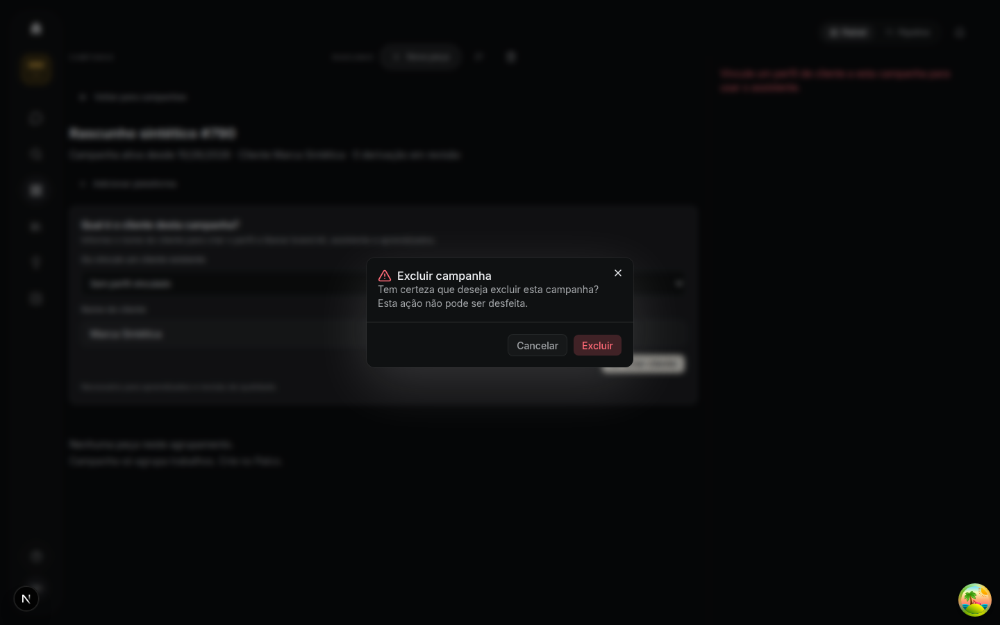
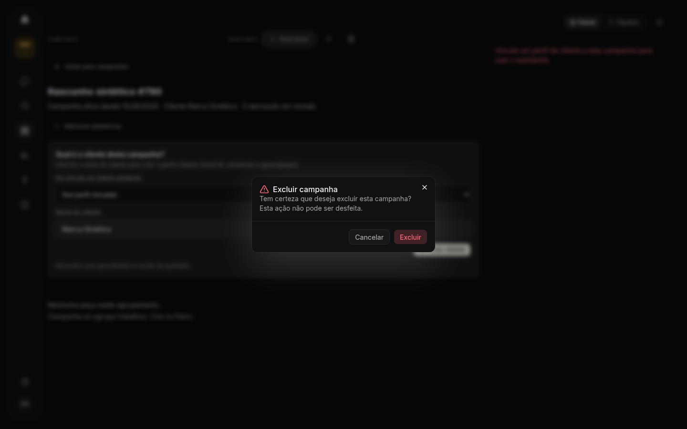

# Página da Campanha depois da limpeza (#790, #791): evidência de browser (2026-10-26)

Antes: `main` em `d0edd952`. Depois: branch `chore/790-791-limpeza-campanha`.

> **Dados sintéticos, banco de teste.** Nenhum dado real foi usado e nenhuma chamada paga foi feita.

## Ambiente

- Postgres de teste (`adscale-test-postgres`, porta 5433), o mesmo para os dois lados.
- `main`: `next dev`, porta 3791. Branch: `next build` + `next start`, porta 3790.
- Env de placeholders no formato do CI, com `E2E_CONTROLLED_PROVIDER=true` e storage local de E2E.
- Browser: Chromium headless (browser in-app do Traycer), viewport 1440×900.
- Seed: usuário de dev `dev790@adscale.local` (`scripts/seed-dev-admin.ts --create`). No workspace dele:
  - duas Campanhas idênticas com 30 Peças e 3 materiais, uma para cada lado, porque vincular a marca altera a Campanha;
  - um rascunho sem Peças, porque o botão de excluir só aparece em rascunho (na `main` também).
- **Imagens nas capturas:** no modo E2E a URL assinada é `e2e-storage://…`, que o browser não carrega. Só para as capturas, um script no browser trocou o `src` por `blob:` URLs dos mesmos arquivos. O app não mudou.

## Capturas

| | `main` (antes) | Branch (depois) |
| --- | --- | --- |
| **A.** Campanha com Peças, marca vinculada pelo seletor da própria página: grade, plataformas e Assistente |  |  |
| **B.** Rascunho sem marca: banner de vínculo de marca, botão de excluir e plataformas |  |  |
| **C.** Diálogo de exclusão aberto |  |  |

## Conferido na branch, sem captura

- **Exclusão:** "Excluir" no diálogo apagou o rascunho do banco e levou para `/campaigns`. O diálogo saiu de `CampaignWorkspaceModals` para o JSX da página.
- **Plataformas:** "Adicionar plataforma" abre o drawer, e salvar "Meta Feed" atualiza o subtítulo.
- **Grade:** "Carregar mais" passa de 27 para 33 tiles (24 + 6 Peças e 3 materiais), e o botão some na última página.
- **Deep link:** `?tab=recipe` e `?tab=generate&mode=preview` abrem a página normal, sem diálogo e sem erro.
- **Contrato:** `GET /assets` devolve `featured: { base }`, e `POST /assets/link` responde 404.
